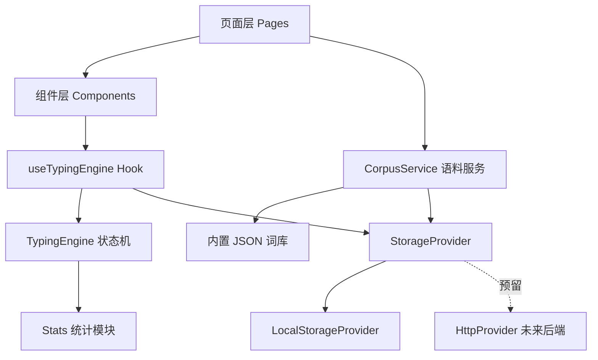

## 用户需求

在空文件夹 `c:/Users/dsq/Desktop/英语打字学习app` 中从零开发一个专注于英语打字练习的 Web 应用，通过打字方式提升英语学习效果。经澄清确认：技术栈 React + TypeScript + Vite；数据采用本地存储（localStorage）并在代码结构上预留后端切换接口；语料采用内置分级词库 + 用户自定义导入；交付范围为核心 MVP（单词/句子练习模式 + 实时反馈），段落模式、完整统计页、深度移动端适配为后续迭代（结构上预留）。

## 产品概述

单页应用（SPA），以练习页为核心：用户选择词库/句子库与难度级别后开始打字，系统逐字符实时校验并反馈（正确/错误高亮、正确率、WPM、用时），练习结束后展示成绩单并记录历史与错词本；支持在词库页粘贴/导入自定义语料。界面现代简洁、响应式基础布局，兼顾桌面与移动浏览器。

## 核心功能

- **单词模式**：按级别（内置 CET4/常用词等 JSON 词库）随机出词，逐词打字，输入错误即时标红
- **句子模式**：随机抽取内置/自定义句子，逐字符校对，支持空格与标点
- **实时反馈面板**：实时显示 WPM（词/分钟）、正确率、用时、进度；错误字符即时高亮与提示音（可关）
- **练习结果页**：完成后展示本次成绩（WPM、正确率、错误最多的字符/单词），错词自动进入错词本
- **词库管理**：浏览内置词库；粘贴文本导入自定义单词/句子列表（localStorage 持久化）
- **数据持久化**：练习历史、错词本、用户设置（音效、键盘提示）经存储抽象层写入 localStorage，预留后端 Provider 切换
- **结构预留**：路由含统计页占位；CSS 响应式基础 + 移动端隐藏输入框聚焦方案，为段落模式和统计页迭代留好接口

## 技术选型

- **框架**：React 18 + TypeScript + Vite（用户指定，生态成熟、组件化、构建快）
- **样式**：Tailwind CSS（原子化、响应式前缀友好，适配 MVP 快速开发）
- **路由**：react-router-dom（练习 / 词库 / 统计占位三路由，预留段落模式）
- **状态管理**：React hooks + 自定义 hook（useTypingEngine），无需引入 Redux，符合 YAGNI
- **存储**：localStorage，经 StorageProvider 接口抽象，默认 LocalStorageProvider 实现
- **构建/脚本**：PowerShell 兼容的 npm scripts（dev / build / preview）

## 实现方案

### 总体策略

采用"打字引擎（纯逻辑） + UI 组件（渲染） + 存储抽象（持久化）"三层分离：打字引擎为纯 TypeScript 状态机，与 React 解耦，保证可测试性与后续模式扩展。

### 关键设计决策

1. **打字引擎（TypingEngine）**：逐字符状态机，每个字符状态为 `pending | correct | wrong`；`input(char)` 处理输入，`backspace()` 处理退格（MVP 中退格仅回退光标、不消除已记录的错误次数，保证统计真实）；同时维护错误字符计数 Map（错误热力）。时间复杂度 O(1)/键击，总复杂度 O(n)，n 为文本长度，无性能瓶颈。
2. **统计计算**：WPM = (正确字符数 / 5) / 分钟数（国际标准）；正确率 = 正确键击 / 总键击。计时在首个键击开始，避免人为等待影响成绩。
3. **存储抽象**：定义 `StorageProvider` 接口（getHistory/addRecord/getErrorBook/addCustomCorpus 等），`LocalStorageProvider` 实现；未来仅需新增 `HttpProvider` 即可切换后端，UI 层零改动（依赖注入于 React Context）。
4. **语料统一接口**：内置 JSON（src/data/）与自定义语料（localStorage）都抽象为 `CorpusSource`（id/name/level/items），引擎与页面不感知来源差异。
5. **移动端输入**：页面挂载一个视觉隐藏的 `<textarea>` 持续聚焦，监听其 input 事件提取逐字符差异；避免 iOS/Android 虚拟键盘无法触发 keydown 的问题。MVP 实现基础可用，深度适配留待迭代。

### 实施注意事项

- **性能**：渲染层按字符生成 span 但使用 `React.memo` 拆分文本行组件，避免每次键击全树重渲染；统计面板用 200ms 节流更新 WPM。
- **兼容性**：localStorage 读写包 try/catch（隐私模式降级为内存存储）；音效使用 Web Audio 短促 beep，无外部资源依赖。
- **日志**：仅 console.warn 记录存储异常，无敏感信息。
- **影响面**：全新项目，无回归风险；不引入超出 MVP 的依赖。

## 架构设计



## 目录结构

```
english-typing-app/  (位于 c:/Users/dsq/Desktop/英语打字学习app)
├── index.html                  # [NEW] Vite 入口 HTML
├── package.json / vite.config.ts / tsconfig.json / tailwind.config.js  # [NEW] 工程配置
├── src/
│   ├── main.tsx                # [NEW] 应用入口，挂载路由与 Storage Context
│   ├── App.tsx                 # [NEW] 路由配置：/practice /corpus /stats(占位)
│   ├── engine/
│   │   ├── typingEngine.ts     # [NEW] 逐字符状态机：input/backspace/状态迁移
│   │   └── stats.ts            # [NEW] WPM/正确率/错误热力计算
│   ├── hooks/
│   │   └── useTypingEngine.ts  # [NEW] React 与引擎桥接，节流推送统计
│   ├── storage/
│   │   ├── types.ts            # [NEW] StorageProvider 接口 + PracticeRecord 等类型
│   │   ├── localProvider.ts    # [NEW] localStorage 实现（含 try/catch 降级）
│   │   └── StorageContext.tsx  # [NEW] 依赖注入 Context
│   ├── services/
│   │   └── corpusService.ts    # [NEW] 统一内置/自定义语料的 CorpusSource 接口
│   ├── data/
│   │   ├── cet4-words.json     # [NEW] 内置分级词库（含中文释义）
│   │   └── sentences.json      # [NEW] 内置常用句库（按难度分级）
│   ├── pages/
│   │   ├── PracticePage.tsx    # [NEW] 练习页：模式/词库/难度选择 + 打字区 + 实时反馈
│   │   ├── CorpusPage.tsx      # [NEW] 词库页：浏览内置词库、粘贴导入自定义语料
│   │   └── StatsPage.tsx       # [NEW] 统计占位页（历史记录简表，后续迭代完善）
│   ├── components/
│   │   ├── TypingArea.tsx      # [NEW] 打字渲染区：逐字符着色（memo 优化）
│   │   ├── StatsPanel.tsx      # [NEW] 实时 WPM/正确率/用时面板
│   │   ├── ResultModal.tsx     # [NEW] 练习结束成绩单 + 错词汇总
│   │   └── NavBar.tsx          # [NEW] 顶部导航（响应式）
│   └── styles/index.css        # [NEW] Tailwind 入口 + 全局主题变量
```

## 关键代码结构

```ts
// storage/types.ts —— 存储抽象核心契约
interface PracticeRecord {
  id: string; mode: 'word' | 'sentence'; level: string;
  wpm: number; accuracy: number; durationSec: number;
  errorChars: Record<string, number>; createdAt: number;
}
interface StorageProvider {
  getHistory(): PracticeRecord[];
  addRecord(r: PracticeRecord): void;
  getCustomCorpus(): CorpusItem[];
  saveCustomCorpus(items: CorpusItem[]): void;
  getSettings(): AppSettings;
  saveSettings(s: AppSettings): void;
}

// engine/typingEngine.ts —— 打字引擎接口
type CharState = 'pending' | 'correct' | 'wrong';
interface TypingEngine {
  input(char: string): void;
  backspace(): void;
  getStates(): CharState[];
  getStats(): { wpm: number; accuracy: number; elapsedSec: number };
  isFinished(): boolean;
  getErrorChars(): Record<string, number>;
}
```

## 设计风格

采用现代极简 + 微动效的专注型学习工具风格：深色侧边点缀的浅色主题，大面积留白让注意力集中在打字文本上；打字区使用等宽大字、逐字符平滑变色过渡，错误字符以红色脉冲微动画提示，完成时成绩单卡片滑入。顶部导航为毛玻璃（glassmorphism）粘性栏。响应式：桌面端打字区最大宽度 880px 居中，移动端全宽、统计面板折叠为底部一行。

## 页面与区块（共 3 页）

**练习页（核心）**：1) 顶部导航栏；2) 模式与配置条（单词/句子切换、词库、难度下拉，胶囊式按钮组）；3) 实时统计面板（WPM/正确率/用时三卡片）；4) 打字区（大号等宽字符流，正确绿/错误红/未输入灰，光标呼吸闪烁，隐藏 textarea 捕获输入）；5) 底部键盘按键提示条（桌面显示，移动端隐藏）。
**词库页**：1) 顶部导航；2) 内置词库卡片网格（级别徽标、词数）；3) 自定义语料导入区块（textarea 粘贴 + 按行解析预览）；4) 已导入列表管理（删除）。
**统计页（占位）**：1) 导航；2) 历史记录简表（日期/模式/WPM/正确率）；3) "更多图表功能即将上线"占位卡片。

## 交互细节

- 键击正确：字符由灰变墨绿，150ms 过渡；错误：红色 + 轻微抖动 + 短促提示音（可关）
- 完成：成绩卡片从底部滑入，WPM 数字滚动动画
- 所有按钮 hover 有上浮阴影微动效