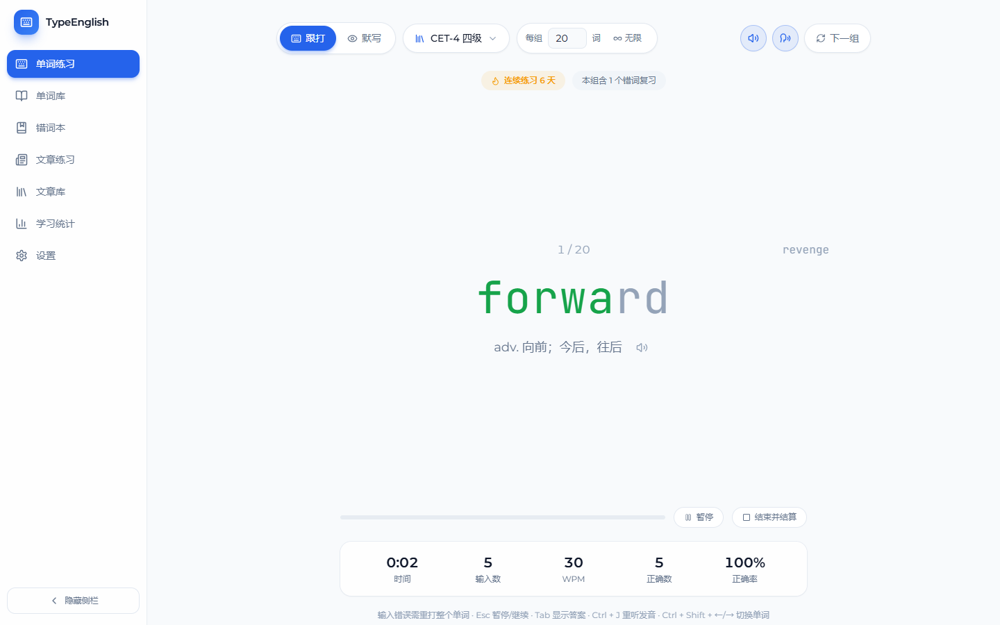
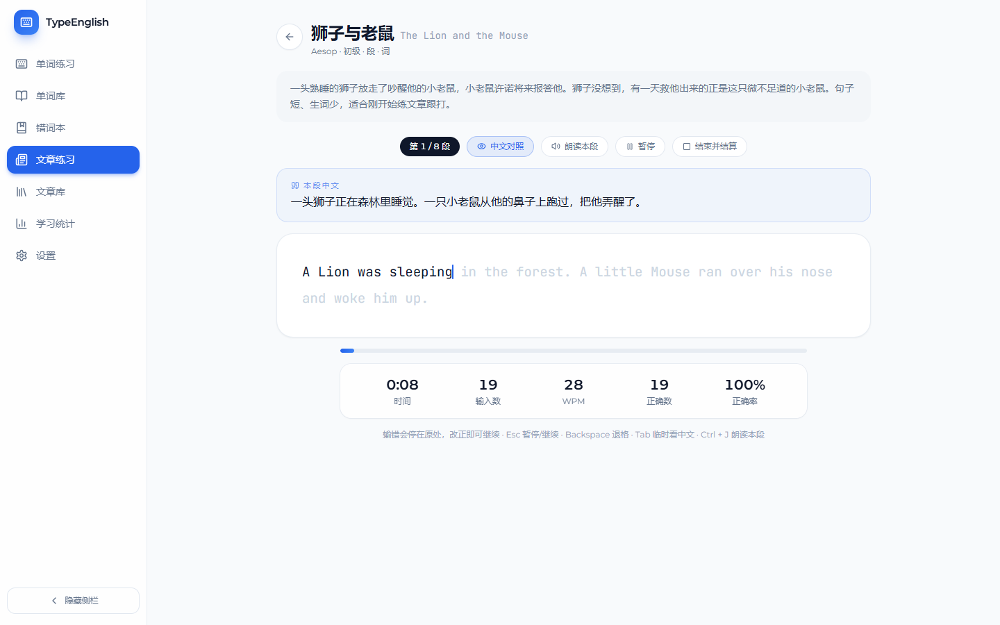
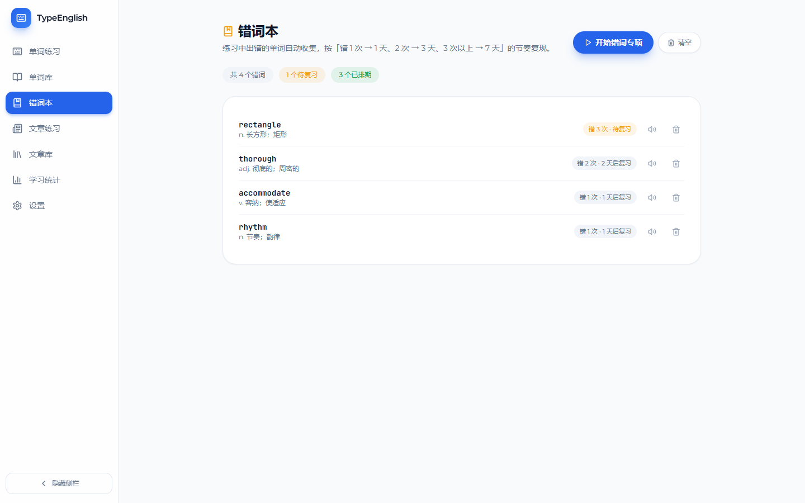
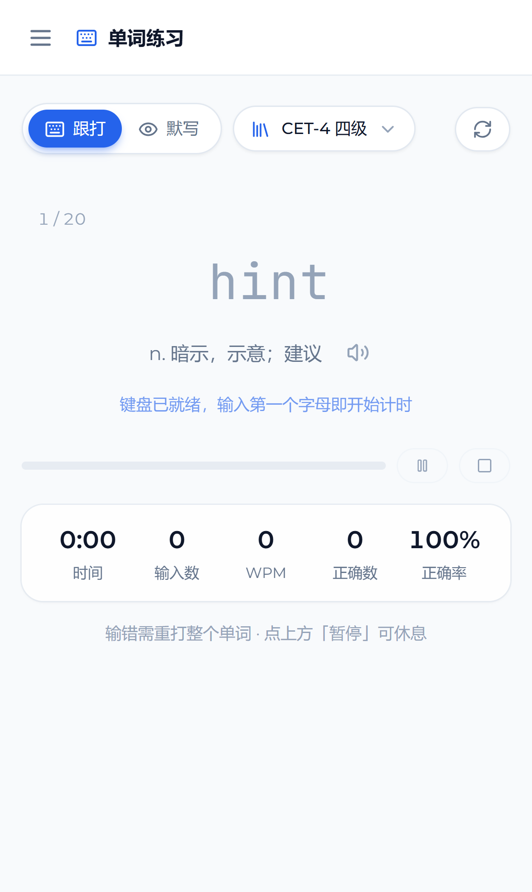

# TypeEnglish · 英语打字练习

> 用键盘把单词和文章「敲」进肌肉记忆 —— 一个纯前端的英语打字学习应用。

**在线体验**：https://fashhhhhh.github.io/english-typing-app/



## 这是什么

TypeEnglish 把「背单词」和「练打字」合成一件事：看着中文提示（或跟着英文原文），手指把对应的英文敲出来。敲错立刻标红并记录，答错的词自动进入错词本，按 1 / 3 / 7 天的间隔重复回到练习队列里。

- **纯前端、零后端**：数据全部存在浏览器 `localStorage`，不上传任何内容，打开即用
- **离线可用**：除在线版外，还可构建成**单个 HTML 文件**（`dist-desktop/index.html`），双击即用、断网也能练
- **五大词库共 27,679 词**：高考 / CET-4 / CET-6 / 考研 / 托福，词表来自开源数据，已清洗去重
- **手机可用**：响应式适配手机浏览器，点击练习区即唤起键盘，键盘弹出自动切换紧凑布局

## 功能

### 单词练习：跟打与默写一键切换

同一个章节、同一批单词，随时切换输入方式，不用重新开一局（章节长度可在设置里改，1 ~ 100 或无限）。

| 模式 | 交互 |
|---|---|
| **跟打** | 英文单词大字居中，逐字母着色；**打错必须整词重打**（错字标红 + 蜂鸣 + 抖动，320ms 后自动重置），打满自动跳下一个；同一词错满 4 次自动跳过，避免卡死 |
| **默写** | 只给中文释义，自己拼出英文，**回车判定**；判错会揭示正确答案，漏输的字母以琥珀色虚线槽显示 |

练完一章可点「**查看原文**」回看本组全部单词（含释义与发音），也可以直接开下一组。练习中错误自动写入错词本，全对的词自动减次退出复习队列。

### 文章练习

内置 3 篇公版经典（欧·亨利《二十年后》1260 词 39 段、伊索寓言《狮子与老鼠》、梭罗《瓦尔登湖》节选），**逐段推进**、中文对照可随时开关，段落完成自动进入下一段，全文结束生成成绩单，并可一键**通读全文**（英文原文＋中文对照）复习。



### 错词本与间隔重复

答错的单词自动收录：错 1 次 → 1 天后复习，错 2 次 → 3 天，3 次以上 → 7 天；到期的错词会**优先混入下一轮练习**（每轮至多占一半），答对一次减一，归零自动移出。也可以点「开始错词专项」集中消化。



### 学习统计

练习次数、平均 / 最佳 WPM、平均正确率，近 16 周每日打卡热力图与连续打卡天数，近 20 次 WPM 趋势图，以及每条历史记录的明细。


### 手机上使用

响应式布局适配手机浏览器：侧栏在小屏收成顶部栏 + 抽屉导航，工具栏自动收纳，单词字号按长度自适应。点击练习区即唤起系统键盘，出现光标与「键盘已就绪」提示。



键盘弹出时自动进入**紧凑布局**：中文对照与单词固定在视野内不被键盘遮挡，统计条压缩为三格、次要按钮只留图标。


- 手机浏览器打开即用，也可「添加到主屏幕」获得接近原生的体验
- 练习数据存在手机浏览器本地，与电脑互不相通，可用「设置 → 备份与恢复」在两端迁移

### 更多细节

- **发音**：判定后自动朗读英文（可关），也可随时点喇叭重听；基于浏览器自带的 Web Speech API，零依赖
- **音效**：机械键盘式按键音、错误蜂鸣、完成提示音，全部用 Web Audio 实时合成，可一键关闭
- **主题**：白天 / 夜晚 / 跟随系统
- **侧边栏**：可折叠隐藏，练习时更专注
- **暂停与结算**：`Esc` 暂停遮罩；随时「结束并结算」当前章节
- **回看原文**：单词章节结算后可回看本章单词表，文章结算后可通读全文与中文对照
- **数据备份**：设置页可把全部数据导出为 JSON，换电脑或清浏览器前先备份，也可导入恢复
- **自定义内容**：可粘贴自己的单词表（`word|释义`，也兼容制表符分隔）和英文文章（英文＋中文译文，空行分段）

### 快捷键（跟打模式）

| 按键 | 作用 |
|---|---|
| `Esc` | 暂停 / 继续 |
| `Tab` | 显示答案 |
| `Ctrl` + `J` | 重听发音 |
| `Ctrl` + `Shift` + `←` / `→` | 切换上一个 / 下一个单词 |
| `Backspace` | 退格修改 |

## 技术栈

React 18 · TypeScript 5 · Vite 5 · Tailwind CSS 3 · React Router（HashRouter）· lucide-react · Recharts（统计图表，按需加载）· Web Audio API · Web Speech API · VisualViewport API（手机键盘感知）· localStorage

词库体积较大（每级数百 KB），实现上按级别**动态 `import()` 懒加载并缓存**，首屏不加载任何词库；统计页同样按需分包。

## 本地运行

```bash
npm install

npm run dev            # 开发服务器 http://localhost:5173
npm run build          # 生产构建 -> dist/（部署用）
npm run build:desktop  # 单文件离线版 -> dist-desktop/index.html（双击即用）
npm run icons          # 重新生成图标（Windows / PowerShell）
```

## 项目结构

```
src/
├── engine/        打字引擎（纯 TS，与 React 解耦）
│   ├── followEngine.ts    跟打/默写章节状态机
│   ├── articleEngine.ts   文章逐段推进引擎
│   └── stats.ts           统计工具
├── hooks/         useFollowEngine / useArticleEngine（React 桥接）
├── pages/         各页面：单词练习、单词库、错词本、文章练习/文章库、学习统计、设置
├── components/    单词面板、进度条、统计条、结果弹窗、热力图、侧边栏等
├── services/      语料服务、文章服务、发音、音效、备份、打卡
├── storage/       StorageProvider 抽象 + LocalStorageProvider 实现
└── data/          内置词库与文章（JSON，按需加载）
scripts/
└── build-word-data.mjs   词表转换脚本（清洗、去重、分级输出）
```

存储层是抽象接口（`src/storage/types.ts` 中的 `StorageProvider`），UI 只依赖接口不依赖实现——将来要接后端，新增一个 `HttpProvider` 并在 `StorageContext` 处替换即可，页面代码不用改。

## 数据与隐私

练习记录、错词本、自定义词库与文章、设置项**全部保存在浏览器本地**，不会上传到任何服务器。因此：

- 换浏览器、清理浏览器数据或使用无痕模式，数据不会跟随，请先在设置页导出备份
- 在线版与你本地的离线单文件版使用**不同的存储空间**，两边数据互相独立

## 部署

仓库已配置 GitHub Actions（`.github/workflows/deploy.yml`）：推送到 `main` 分支后自动构建并发布到 GitHub Pages，约 1 分钟生效。

## 词库与内容来源

- **词库**：整理自开源词表 [Travisun/english-vocabulary](https://github.com/Travisun/english-vocabulary)（数据源自 [kajweb/dict](https://github.com/kajweb/dict)），经 `scripts/build-word-data.mjs` 清洗、去重、截断释义后生成
- **文章**：均为公有领域作品 —— 欧·亨利《The Four Million》(1906)、伊索寓言、梭罗《Walden》(1854)
- **交互设计**参考了 [Qwerty Learner](https://github.com/Kaiyiwing/qwerty-learner)（连续跟打、错词重打）与 [TypersGuild](https://typersguild.com/)（打卡热力图、成长反馈）

## 声明

个人学习项目，代码可自由参考使用；内置词库数据的版权归上述原项目所有，文章为公有领域作品。
